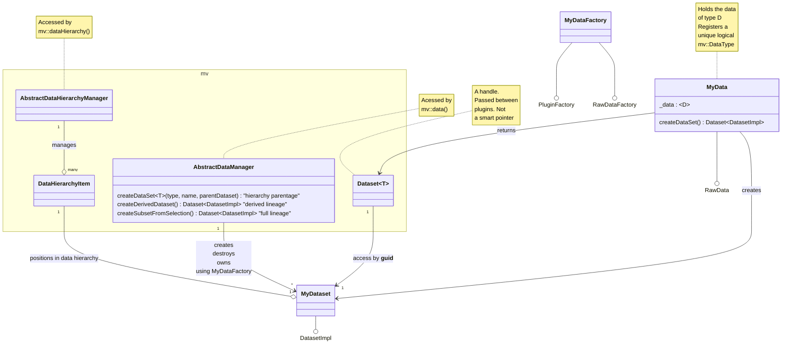

## This Plugin

An data plugin that exhibits inter-repo dependencies. This is repo is a dependency 
for FooDataLoader. The underlying data is represents an array of complex numbers as std::vector<std::complex<float>>

Together they act as a test for the resolution of inter-repo dependency
resolution using our orchestation tools on github CI (ManiVaultStudio/github-actions)
and in desktop development (DevBundle) 

## Manivault data model for a new data type

